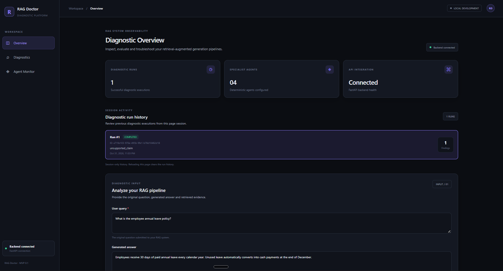
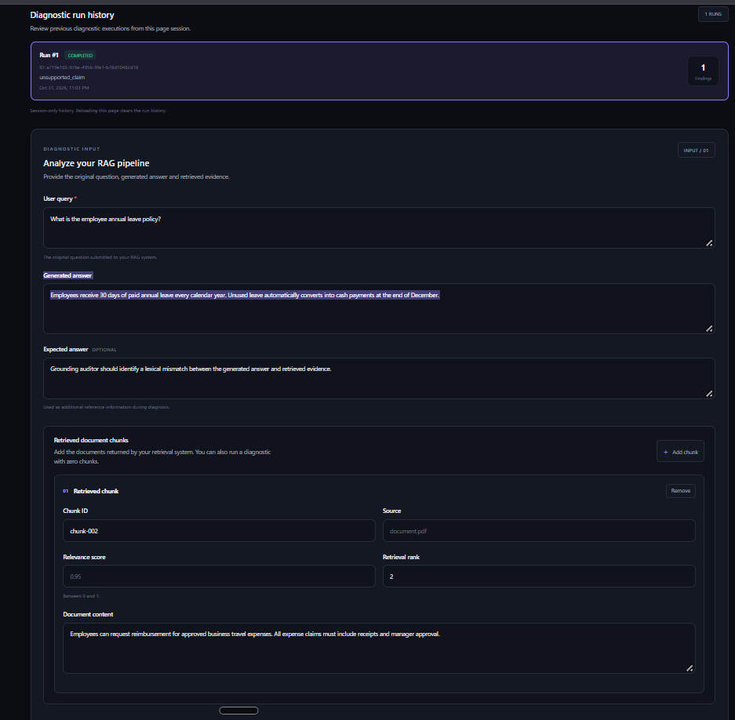
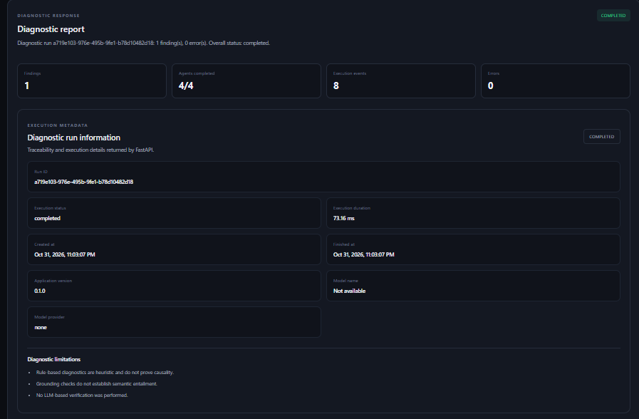
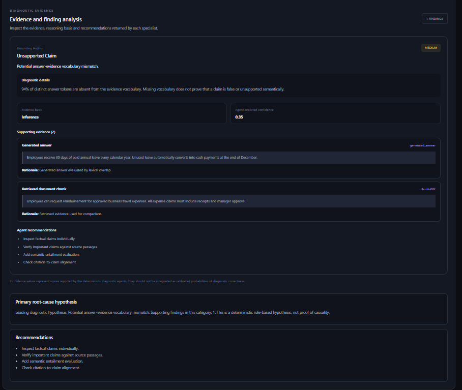
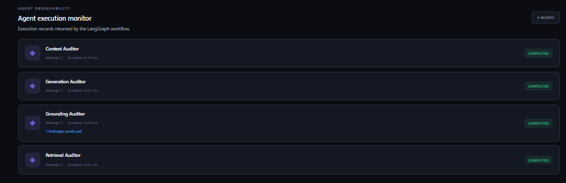
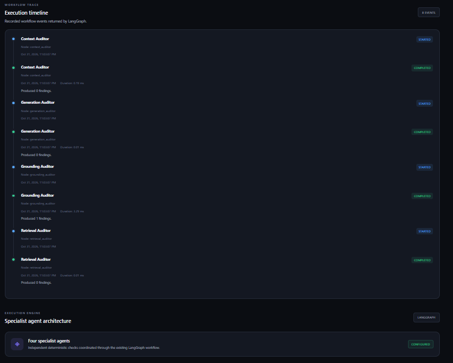

# RAG Doctor

### Explainable RAG Diagnostics and Observability Platform

RAG Doctor is a diagnostic platform for inspecting and evaluating common failure modes in Retrieval-Augmented Generation (RAG) systems.

It uses four deterministic specialist auditors coordinated through LangGraph to examine retrieval quality, context construction, answer grounding, and generation output.

The platform provides evidence-backed findings, root-cause hypotheses, agent execution records, workflow timelines, and reproducible diagnostic evaluations.

> **Project status:** Functional MVP. The diagnostic engine is deterministic and does not currently use an LLM for verification.

## 1. Project Overview

RAG systems can fail at multiple stages:

- Relevant documents may not be retrieved.

- Retrieved documents may be duplicated.

- Retrieved chunks may be omitted during context assembly.

- Generated answers may contain vocabulary absent from the available evidence.

- The generation process may return an empty answer.

RAG Doctor analyzes these failure patterns and produces structured diagnostic reports.

## 2. Key Features

- Multi-agent diagnostic workflow using LangGraph.

- Retrieval quality auditing.

- Context construction and duplication checks.

- Lexical answer-grounding analysis.

- Empty generation detection.

- Evidence-backed findings and recommendations.

- Agent execution records and diagnostic timelines.

- FastAPI backend with a React dashboard.

- Golden test cases and a reproducible evaluation runner.


## 3. Application Screenshots

### Dashboard Overview



### Diagnostic Input



### Diagnostic Report



### Evidence and Findings



### Agent Execution Monitor



### Workflow Execution Timeline




## 4. Architecture

The diagnostic workflow coordinates four specialist auditors:

| Agent | Responsibility |

|---|---|

| Retrieval Auditor | Detects empty retrieval and low relevance scores |

| Context Auditor | Detects empty context, omitted chunks, and duplicate content |

| Grounding Auditor | Screens for lexical mismatch between answer and evidence |

| Generation Auditor | Detects empty or whitespace-only generated answers |

The workflow aggregates specialist findings into a unified diagnostic report containing severity, evidence, recommendations, limitations, and a primary root-cause hypothesis.

## 5. Technology Stack

**Backend:** Python, FastAPI, Pydantic, LangGraph

**Frontend:** React, Vite, JavaScript, CSS

**Testing and Evaluation:** Pytest, HTTPX, JSON-based golden test cases

## 6. Project Structure

```text

rag-doctor/

├── backend/

│   ├── api/

│   ├── graph/

│   ├── services/

│   └── main.py

├── evaluation/

│   ├── golden_cases.json

│   └── run_benchmark.py

├── frontend/

│   ├── src/

│   │   ├── components/

│   │   └── services/

│   └── package.json

├── tests/

├── .gitignore

├── README.md

└── requirements.txt

```

## 7. Setup and Installation

### Prerequisites

- Python 3.11

- Node.js and npm

### Backend Setup

From the project root:

```powershell

py -3.11 -m venv .venv

.\\.venv\\Scripts\\python.exe -m pip install -r requirements.txt

.\\.venv\\Scripts\\python.exe -m uvicorn backend.main:app --reload --host 127.0.0.1 --port 8000

```

Backend health endpoint:

```text

http://127.0.0.1:8000/health

```

API documentation:

```text

http://127.0.0.1:8000/docs

```

### Frontend Setup

Open a second terminal:

```powershell

cd frontend

npm install

npm run dev

```

Frontend:

```text

http://localhost:5173

```

## 8. API

The main diagnostic endpoint is:

```text

POST /api/v1/diagnostics

```

The endpoint accepts diagnostic input and returns a structured report containing findings, agent executions, execution events, metadata, and errors.

## 9. Testing

Run backend regression tests from the project root:

```powershell

.\\.venv\\Scripts\\python.exe -m pytest -v

```

## 10. Evaluation Benchmark

The evaluation suite contains seven predefined golden test cases covering:

- Empty retrieval

- Matching answer with retrieved evidence

- Lexical answer-evidence mismatch

- Low retrieval relevance

- Duplicate context

- Empty assembled context

- Empty generated answer

Start the backend before running the benchmark:

```powershell

.\\.venv\\Scripts\\python.exe evaluation/run_benchmark.py

```

The latest recorded benchmark run passed all seven predefined cases.

**Important:** The reported 100% expected-output agreement applies only to these seven test cases. It is not a measurement of real-world accuracy, precision, recall, or semantic correctness.

## 11. Current Limitations

- The diagnostic engine uses deterministic heuristics rather than LLM-based semantic verification.

- Grounding analysis relies on lexical overlap and cannot establish semantic entailment.

- Retrieval relevance checks depend on supplied relevance scores.

- The benchmark covers a limited set of predefined scenarios.

- Run history is maintained in the browser session and is not persistent across reloads.

RAG Doctor is an explainable diagnostic MVP intended to help developers identify and investigate common RAG pipeline failure patterns.
